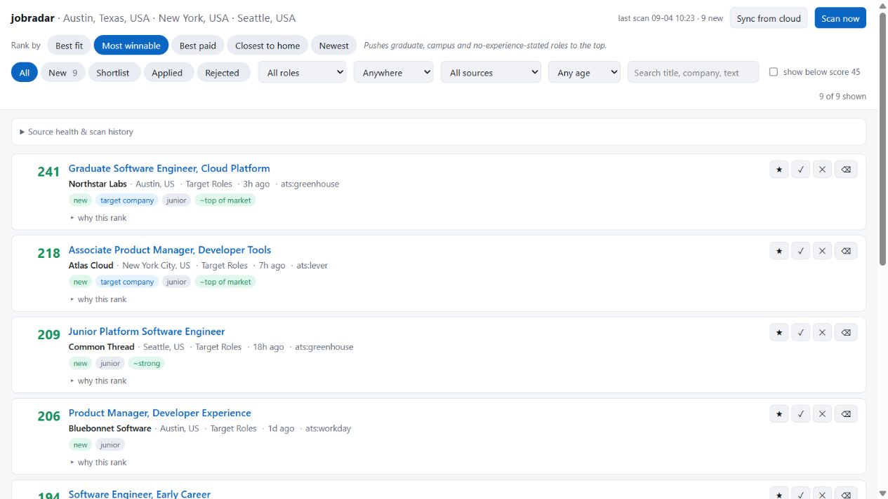

# jobradar

Jobradar polls company career systems and selected job boards, scores postings
against your own criteria, and serves the results in a local dashboard. The
matching rules are plain YAML, and every score component is visible.



```text
jobradar init          # create a private profile and search configuration
jobradar geo-update    # download the city dataset once
jobradar discover      # identify the ATS used by companies on your list
jobradar scan          # collect and rank current postings
jobradar serve         # dashboard at http://127.0.0.1:8765
```

The setup wizard accepts arbitrary target titles: accountant, mechanical
engineer, nurse, product manager, software engineer, or anything else. It turns
the titles into search queries and literal ranking patterns rather than forcing
you into a fixed profession menu.

## How it finds jobs

The primary source is the public job-board interface exposed by common applicant
tracking systems, including Greenhouse, Lever, Ashby, SmartRecruiters, Workday,
Personio, Workable, Recruitee, Teamtailor, and join.com. A company seed list can
usually contain just a name and domain; `jobradar discover` fingerprints the
career page and verifies any board it finds.

The scanner also includes Arbeitnow and amazon.jobs, plus optional Adzuna and
Jooble integrations. Regional adapters and the LinkedIn guest endpoint ship
disabled where appropriate. Source availability and terms can change, so review
the comments in `config/settings.example.yaml` before enabling an optional source.

## Install

Python 3.11 or newer is required.

macOS or Linux:

```bash
git clone https://github.com/Akareps/job-radar.git
cd job-radar
python3 -m venv .venv
source .venv/bin/activate
python -m pip install -e .
jobradar init
```

Windows PowerShell:

```powershell
git clone https://github.com/Akareps/job-radar.git
Set-Location job-radar
py -m venv .venv
.venv\Scripts\Activate.ps1
python -m pip install -e .
jobradar init
```

If activation is unavailable, use the virtual environment directly, for
example `.venv\Scripts\python.exe -m pip install -e .` and
`.venv\Scripts\python.exe -m jobradar init`.

The wizard writes ignored, local-only files under `config/` and copies the small
example employer list to `config/seed_companies.yaml`. Edit that list, then run:

```bash
jobradar geo-update
jobradar discover
jobradar scan
jobradar serve
```

### Optional CV assistance

Install the optional dependencies with:

```bash
python -m pip install -e ".[cv]"
```

With `ANTHROPIC_API_KEY` set, or credentials configured by `ant auth login`, you
can run `jobradar init --cv /path/to/cv.pdf`. The wizard explains that the CV
text will be sent to Anthropic and asks for confirmation before uploading it.
Extracted roles, education, skills, location, and seniority are only editable
defaults; each is displayed before the configuration is written. API usage is
billed by the provider, so check current pricing before using this option.

CV extraction is optional. The normal wizard asks the same questions locally.

## Private data and security

By default, configuration, the SQLite database, logs, CV filenames, and `.env`
files are ignored by Git. Before publishing a fork, still check `git status` and
the repository history: ignoring a file does not erase a copy committed earlier.

Network behavior:

- Scanning sends search terms and locations to the enabled job sources.
- Optional CV assistance sends extracted document text to Anthropic after an
  explicit confirmation prompt.
- The local dashboard has no login. Keep the default `127.0.0.1` binding. Do not
  use `--host 0.0.0.0` unless you put an authenticated proxy in front of it.
- The optional GitHub Actions example uploads a job database to your repository.
  Use it only in a private fork and review its secrets and retention behavior.

Request logs record hosts and error types, not complete URLs, query strings, or
exception bodies. This prevents API keys embedded in provider URLs from being
written to `data/scan.log`.

## Configuration

`jobradar init` creates:

- `config/profile.yaml`: target-title patterns, seniority, skills, languages,
  location bands, employer preferences, and scoring weights.
- `config/settings.yaml`: search queries, locations, enabled sources, and paths.
- `config/seed_companies.yaml`: companies to examine during discovery.

API keys belong in ignored `config/secrets.yaml`:

```yaml
adzuna:
  app_id: "..."
  app_key: "..."
jooble:
  api_key: "..."
```

Adzuna stays disabled until you explicitly provide supported ISO-2 country codes
and a `where` mapping. The wizard does not guess country codes from free-form city
names.

### Location scoring

Locations are scored by great-circle distance using GeoNames `cities5000`
(CC BY 4.0), cached under `data/`. Without the dataset, the generated
`name_hints` still provide a basic local/hub match.

```yaml
location:
  home: "Berlin, Germany"
  bands:
    - {within_km: 40, tier: local, points: 32}
    - {within_km: 150, tier: regional, points: -6}
  also_good:
    - {place: "Amsterdam, Netherlands", tier: hub, points: 16, within_km: 40}
```

### Ranking

The balanced score is:

```text
role weight × (1 + sum(adjustments) / 100), followed by optional hard caps
```

Adjustments cover seniority, stated experience, distance, freshness, language,
employer preference, and skill overlap. The dashboard can reweight stored score
components for “Most winnable”, “Best paid”, “Closest to home”, and “Newest”
views without rescanning. Pay bands are user-supplied estimates, not salary data.

Role-family order matters: the first matching family wins. `jobradar init` puts
the literal patterns for your chosen titles first and keeps the bundled patterns
only as lower-priority fallbacks. After editing `profile.yaml`, run
`jobradar rescore`.

## Adding companies

A name and domain are sufficient for discovery:

```yaml
companies:
  - {name: Example Company, domain: example.com, tier: B}
```

If you know the board already, specify it directly:

```yaml
companies:
  - {name: Example Labs, platform: greenhouse, token: examplelabs, tier: A}
  - name: Example Corp
    platform: workday
    token: example/Careers
    host: example.wd3
    search: [Berlin, Germany, Remote]
```

Discovery guesses are verified against the employer name when the platform
provides one. Run `jobradar verify` occasionally because boards are renamed and
companies change systems.

## Scheduling

For a local schedule, use cron on macOS/Linux or
`scripts/install_scheduler.ps1` on Windows. The scheduler runs the virtual
environment's Python executable and uses `data/scan.lock` to prevent overlapping
scans.

Cloud scanning is intentionally not active in a fresh public clone. An opt-in
template lives at `examples/github-actions-scan.yml`. Copy it to
`.github/workflows/scan.yml` only in a private fork, add the documented repository
secrets, inspect the workflow, and enable its schedule yourself. It stores only a
compressed database on a `radar-state` branch; logs and configuration are not
published there.

## Commands

| Command | Purpose |
|---|---|
| `init` | Generate local configuration, optionally using CV hints |
| `geo-update` | Download the GeoNames city cache |
| `discover` | Find ATS boards for the seed company list |
| `verify` | Recheck discovered boards |
| `scan` | Collect and score postings |
| `serve` | Open the local dashboard |
| `top` | Print the best current matches |
| `rescore` | Reapply the profile without rescanning |
| `health` | Show source and scan status |
| `compact` | Prune stale untriaged rows and shrink the database |
| `sync` | Merge an opt-in cloud scanner's database |

## Tests

Run the full offline suite from an activated environment:

```bash
python scripts/test_geo.py
python scripts/test_scoring.py
python scripts/test_text.py
python scripts/test_db.py
python scripts/test_lock.py
python scripts/test_wizard.py
python scripts/test_http.py
python scripts/test_cvparse.py
```

The geographic tests use extra distance cases when the optional city cache is
present and otherwise run their offline checks. `scripts/smoke_test.py` contacts
live job sources and is not part of CI.

MIT licensed. GeoNames data is separately attributed under CC BY 4.0.
